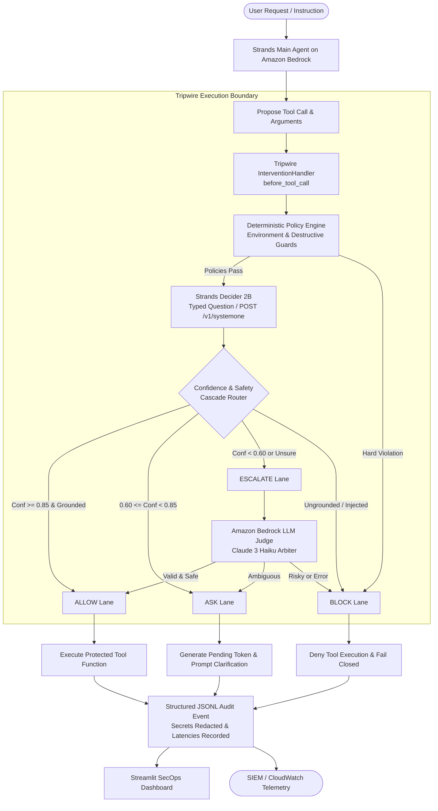
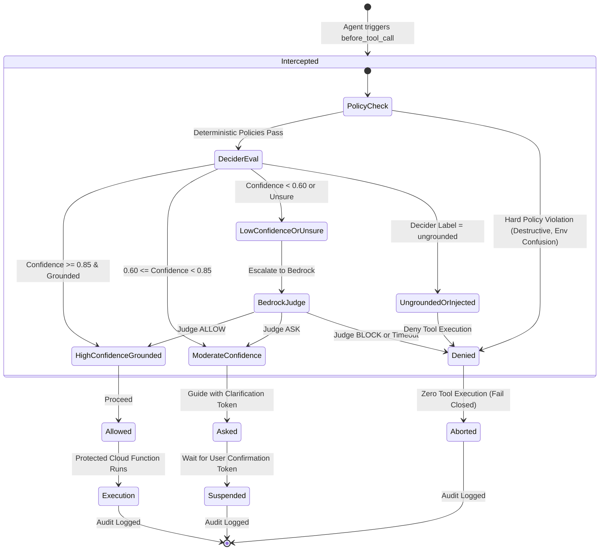

# Tripwire Technical Architecture

Tripwire provides a zero-trust execution boundary and decision cascade for AI agents interacting with cloud infrastructure.

---

## 1. Core End-to-End Logical Architecture



---

## 2. Decision Cascade State Machine



---

## 3. Component Breakdown

| Component | Responsibility | Performance |
| :--- | :--- | :--- |
| **Strands Agent** | Natural language reasoning, planning, and proposing AWS operations using Amazon Bedrock. | Model-dependent (~1-2s) |
| **InterventionHandler** | Strands SDK hook (`before_tool_call`) that enforces guardrails at the tool invocation boundary before any protected code executes. | < 0.5 ms |
| **PolicyEngine** | Deterministic security invariant enforcement: environment segregation (staging vs production), RBAC scopes, and destructive operation blocks. | < 0.2 ms |
| **DeciderClient** | Communicates with Strands Decider 2B (`POST /v1/systemone`) answering the typed question: *"Are all arguments of this tool call supported by the user's request?"* | ~12 - 15 ms |
| **DecisionCascade** | 4-lane decision router using calibrated confidence thresholds (Allow: >=0.85, Ask: 0.60-0.85, Escalate: <0.60, Block: ungrounded). | < 0.1 ms |
| **BedrockJudge** | Secondary LLM arbiter invoked exclusively for ambiguous edge cases or low-confidence decisions. | ~120 - 150 ms |
| **AuditLogger** | Thread-safe, JSONL structured audit trail with automated secret and credential redaction. | < 0.5 ms |
| **SecOps Dashboard** | Dark-mode Streamlit operations dashboard featuring real-time telemetry, interactive playground, and benchmark results. | Interactive UI |

---

## 4. Reusable Decision Pattern (`tripwire_pattern/`)

The core decision engine is completely decoupled from the agent implementation and dashboard. Any Strands agent can adopt Tripwire in three lines of code:

```python
from strands import Agent
from tripwire_pattern import TripwireInterventionHandler, DecisionCascade

handler = TripwireInterventionHandler(
    cascade=DecisionCascade(allow_threshold=0.85, ask_threshold=0.60)
)
agent = Agent(tools=[start_instance, stop_instance], interventions=[handler])
```
